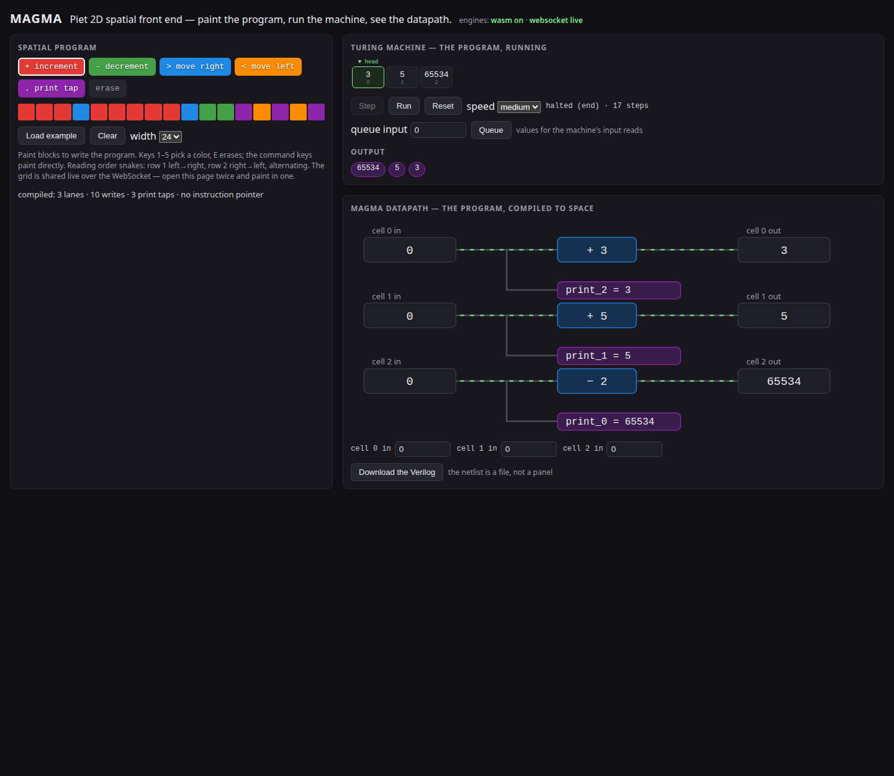

# MAGMA Spatial Compiler

[](https://ahmadaliparr.github.io/magma-spatial/)
[](https://github.com/AHMADALIPARR/magma-spatial)
[](https://www.rust-lang.org)
[](https://github.com/AHMADALIPARR/magma-spatial)

A Rust compiler that translates statically-addressed Brainfuck into parallel, combinational Verilog. The data pointer is resolved at compile time, so each memory cell becomes an independent 16-bit lane with its final value wired directly to an output - no instruction pointer, no clock, no runtime interpreter in the generated RTL.

[](https://ahmadaliparr.github.io/magma-spatial/)

## Build

```sh
cargo build --release
```

## Usage

```console
$ cargo run --release -- compile examples/parallel.bf > parallel.v
compiled: 3 cells, 10 writes, 3 output taps, no instruction pointer
```

The supported instruction subset is `+ - > < .` with a statically-known pointer. Programs using `[`, `]`, or `,` are rejected with a diagnostic naming the character index. Output is capped at 4096 cells.

## Front end

The front end is a 2D spatial editor: the program is painted as colored blocks on a grid, compiled by the same library (built to WebAssembly), executed on a steppable Turing machine view, and drawn as its compiled datapath. Live demo: [ahmadaliparr.github.io/magma-spatial](https://ahmadaliparr.github.io/magma-spatial/).

Run it locally:

```sh
sh web/build-wasm.sh
cargo run --release --bin magma-server
# http://127.0.0.1:8765/
```

`magma-server` also speaks WebSocket: every connected browser shares one grid, and edits broadcast to all clients.

## Tests

```sh
cargo test
sh tests/smoke.sh
```

## License

Dual-licensed under AGPL-3.0-only and the SnapKitty Opaque License. See [LICENSE](LICENSE) and [SNAPKITTY_OPAQUE_LICENSE.md](SNAPKITTY_OPAQUE_LICENSE.md).
